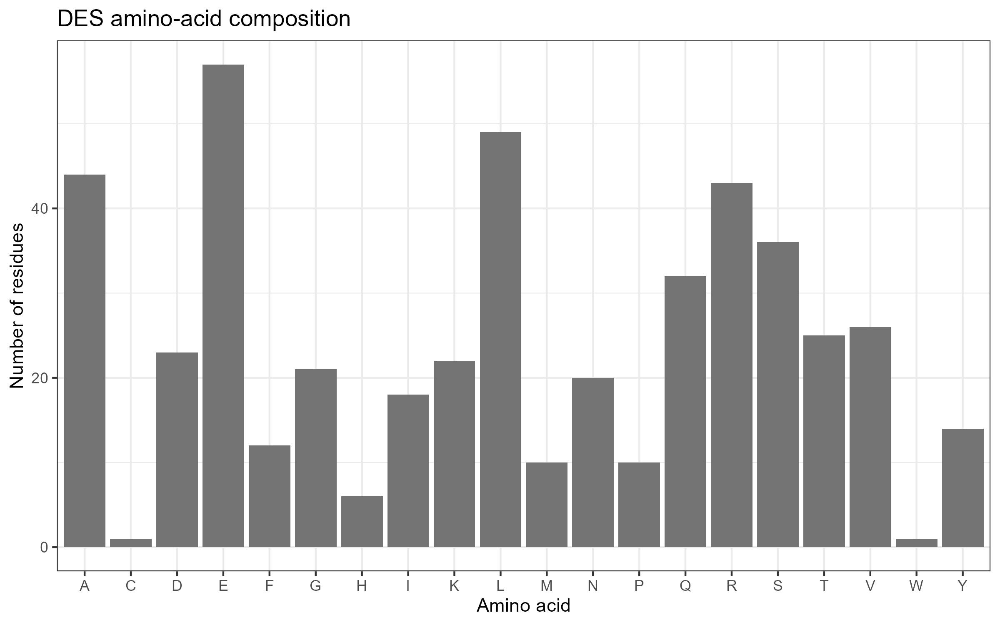
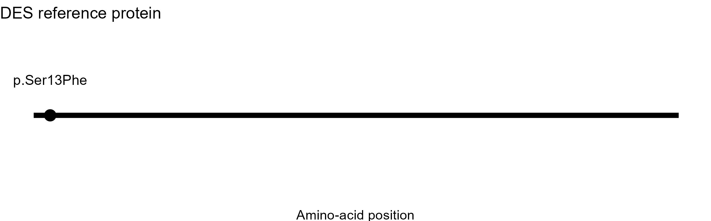
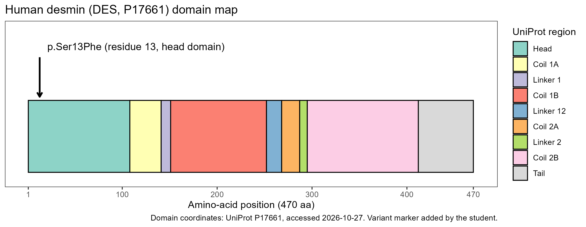

# Muscle-Contractility-DES

**Course:** Cell and Molecular Biology (Ch 09 activity): Molecular Mechanisms of Muscle Contractility

**Student:** Rhealyn F. Alama

**Assignment:** #36, DES, NM_001927.4:c.38C>T (p.Ser13Phe), ClinVar 44260

**Dates accessed:** 2026-10-27 for the databases and papers listed in section (g), except PubMed 17720647 (2026-10-28)

---

## (a) Assignment

| Item | Value |
|---|---|
| Assignment number | 36 |
| Gene | DES (desmin) |
| NCBI Gene ID | 1674 |
| Chromosome | 2 (cytogenetic band 2q35) |
| Transcript | NM_001927.4 |
| Variant | c.38C>T (p.Ser13Phe) |
| Matching protein | NP_001918.3 (desmin isoform 1) |
| ClinVar Variation ID | 44260 |
| Variant class | Missense |

## (b) Research question

How is the desmin missense variant p.Ser13Phe, located near the N-terminus of the protein, associated with muscle disease, and what do the experimental, clinical, and computational evidence each support about its effect on muscle integrity?

---

## (c) Methods

All code is in `analysis.R`. R 4.4.2 on Windows 11; packages rentrez 1.2.4 and ggplot2 4.0.3.

1. Created the folder `Muscle_Contractility_DES` as an RStudio project. The script creates the subfolders `data`, `results`, and `figures`.
2. Installed the packages once with `install.packages(c("rentrez", "ggplot2"))` and loaded them with `library(rentrez)` and `library(ggplot2)`.
3. Set the assignment values: `gene_symbol <- "DES"`, `transcript_accession <- "NM_001927.4"`, `clinvar_id <- "44260"`, `variant_protein <- "p.Ser13Phe"`.
4. Searched NCBI Gene with `entrez_search(db = "gene", term = "DES[Gene Name] AND txid9606[Organism]")`, confirmed the exact symbol with `entrez_summary()`, and saved `results/gene_summary.txt`.
5. Fetched the GenBank record of NM_001927.4 with `entrez_fetch(db = "nuccore", rettype = "gb")`, extracted the NP_ accession from the `/protein_id` field with a regular expression, fetched the protein FASTA with `entrez_fetch(db = "protein", rettype = "fasta")`, and saved `data/DES_protein.fasta` and `results/protein_accession.txt`.
6. Read the FASTA, counted the 20 standard amino acids with `table(factor(...))`, saved `results/amino_acid_composition.csv`, and plotted the counts with ggplot2 (`figures/01_amino_acid_composition.png`).
7. Extracted the residue number from `p.Ser13Phe` and plotted a linear protein map with the variant marked (`figures/02_variant_position.png`).
8. Opened ClinVar record 44260 in a browser and recorded its fields manually (see Results). Read the PubMed abstracts of the three cited papers (see References).
9. Read the domain coordinates of UniProt P17661 from its Family & Domains table, drew a to-scale domain map of the 470-residue protein, and marked residue 13 (`figures/protein_structure_or_splice_diagram.png`).

**Errors corrected:** None.

**To rerun from a fresh R installation:**
1. Install R and RStudio and open this folder as a project.
2. Run `install.packages(c("rentrez", "ggplot2"))` once.
3. Open `analysis.R` and click Source. An internet connection is needed because the script queries NCBI.
4. If an NCBI request fails temporarily, rerun only that section. The assigned gene and variant are never changed.

---

## (d) Results

### NCBI Gene and protein
- Official name: desmin. Gene ID 1674. Chromosome 2.
- Retrieved protein: **NP_001918.3** (desmin isoform 1), **470 amino acids**.
- The script takes the NP_ accession from the GenBank record of the assigned transcript NM_001927.4. ClinVar's protein HGVS for this variant names the same accession (NP_001918.3:p.Ser13Phe), so no other isoform was used.
- The retrieved sequence begins MSQAYSSSQRVSSY..., so residue 13 is serine. This matches the assigned p.Ser13Phe numbering.

### Amino-acid composition
The three most abundant residues are **Glu (E) 57, Leu (L) 49, and Ala (A) 44**.

### Variant position

Residue 13 lies very close to the N-terminus.

### Domain map

Domain coordinates are from UniProt P17661 (accessed 2026-10-27). The variant marker was added by the student.

| UniProt region | Positions |
|---|---|
| Head | 2-108 |
| IF rod domain | 108-416 |
| Coil 1A | 109-141 |
| Linker 1 | 142-151 |
| Coil 1B | 152-252 |
| Linker 12 | 253-268 |
| Coil 2A | 269-287 |
| Linker 2 | 288-295 |
| Coil 2B | 296-412 |
| Tail | 413-470 |

**Residue 13 falls in the head domain (positions 2-108).** In the UniProt Feature viewer, the embedded AlphaFold model has very low confidence (pLDDT < 50) over the N-terminal region, so a predicted structure would say little about residue 13. For this reason I used the domain schematic and not a structure image.

### ClinVar record (accessed 2026-10-27)

| Field | Value |
|---|---|
| Variant name | NM_001927.4(DES):c.38C>T (p.Ser13Phe) |
| Accession | VCV000044260.27 |
| Protein HGVS | NP_001918.3:p.Ser13Phe |
| Type | Single nucleotide variant, 1 bp; molecular consequence: missense |
| Location | 2q35; GRCh38 2:219418500; GRCh37 2:220283222 |
| Aggregate classification | Pathogenic (5) |
| Review status | Criteria provided, multiple submitters, no conflicts (2 stars) |
| Submissions | 10 total; 5 contributed to the aggregate classification |
| First in ClinVar | Oct 19, 2013 |
| Last submission | Sep 22, 2026 |
| Last evaluated | Oct 29, 2025 |
| Conditions reported | Myopathy, myofibrillar, 1; desmin-related myofibrillar myopathy; DES-related disorders |
| Population frequency | TOPMed 0.00000 |
| Other identifiers | dbSNP rs62636495; OMIM 125660.0019; UniProtKB P17661 (VAR_067208) |
| PubMed IDs listed | 17720647, 18061454, 19763525, 19879535, 22215463, 22403400, 23349452, 26097489 |

**Notes on the record**
- The classification was not changed and showed no conflict at the time of access.
- Five of the ten submissions do not contribute to the aggregate. They include a literature-only OMIM entry, three data-share entries from the Netherlands, and one Singapore entry labeled "not provided".
- Submitters use different condition names, and one submission states that the disease assignment is uncertain.

---

## (e) Variant interpretation

The variant c.38C>T changes codon 13 of DES from serine to phenylalanine. A small polar residue is replaced by a large nonpolar aromatic one in the N-terminal head domain (positions 2-108), inside a conserved nine-residue motif (SSYRRTFGG) described by Sharma et al. Because this is a missense change, a full-length protein with one substituted residue is expected, not a truncated protein. ClinVar classifies the variant as Pathogenic, and the evidence behind that classification is separated into experimental, clinical, and predicted categories in the discussion below.

**Causal chain (gene to possible effect)**

**DES gene → desmin protein → intermediate filament network linking Z-discs, myofibrils, and the sarcolemma (muscle structure) → p.Ser13Phe in the head domain → abnormal desmin assembly (reported) → possible loss of myofibril alignment and muscle integrity.**

Step by step:

1. **Gene:** *DES* on chromosome 2q35 encodes desmin.
2. **Protein:** a 470-residue muscle intermediate filament protein (NP_001918.3).
3. **Molecular function:** desmin filaments link Z-discs, neighboring myofibrils, and the sarcolemma. The protein maintains muscle structure. It does not drive the actin-myosin cycle or regulate calcium.
4. **Assigned variant:** p.Ser13Phe in the head domain (positions 2-108), at a reported protein kinase C phosphorylation site.
5. **Reported molecular effect:** abnormal assembly in cells, with desmin accumulations or aggregates. Loss of a phosphorylatable serine is a possible contributor, but it is not demonstrated.
6. **Possible effect on muscle:** disturbed filament networks could weaken myofibril alignment and muscle integrity, which fits the association of S13F with myopathy and cardiac conduction disease. Contraction and relaxation were not directly measured in the papers I read, so I make no claim about them.

---

## (f) Limitations and validation experiment

**Limitations**
- ClinVar classifications can be updated. This report reflects the record on 2026-10-27.
- Only 5 of 10 submissions contribute to the aggregate, and several reports describe related Dutch families that share an ancestor, so they are not fully independent.
- Amino-acid composition cannot show function or the effect of a variant.
- A marker on a protein map gives a sequence position, not proof of a changed molecular interaction.
- The cell-culture experiments described in the abstracts and in the ClinVar/OMIM text (which names BHK21 and MCF7 cells) are not experiments in muscle fibers, so they may not reproduce muscle behavior. The two papers I read also differ in detail (see the discussion), so the cellular effect is not fully settled.
- I read the abstracts, not the full text, of the three papers, and I ran no structural or computational analysis of the variant myself.

**Proposed validation experiment**
Express wild-type desmin, S13F desmin, and a 1:1 mixture in a desmin-null muscle cell line (for example differentiated myotubes) and compare filament networks by immunofluorescence and aggregate size by image quantification. Include a phospho-mimetic S13D and a non-phosphorylatable S13A construct to test whether the loss of a phosphorylatable serine explains the defect. Confirm assembly with a sedimentation assay or electron microscopy.

---

## (g) Sources and access dates

| Source | Link | Accessed |
|---|---|---|
| NCBI Gene (DES, ID 1674) | https://www.ncbi.nlm.nih.gov/gene/1674 | 2026-10-27 |
| RefSeq transcript NM_001927.4 | https://www.ncbi.nlm.nih.gov/nuccore/NM_001927.4 | 2026-10-27 |
| RefSeq protein NP_001918.3 | https://www.ncbi.nlm.nih.gov/protein/NP_001918.3 | 2026-10-27 |
| ClinVar variation 44260 | https://www.ncbi.nlm.nih.gov/clinvar/variation/44260/ | 2026-10-27 |
| UniProt P17661 (DESM_HUMAN) | https://www.uniprot.org/uniprotkb/P17661/entry | 2026-10-27 |
| PubMed 19763525 | https://pubmed.ncbi.nlm.nih.gov/19763525/ | 2026-10-27 |
| PubMed 18061454 | https://pubmed.ncbi.nlm.nih.gov/18061454/ | 2026-10-27 |
| PubMed 17720647 | https://pubmed.ncbi.nlm.nih.gov/17720647/ | 2026-10-28 |

**References**
1. Sharma S, Mücke N, Katus HA, Herrmann H, Bär H. Disease mutations in the "head" domain of the extra-sarcomeric protein desmin distinctly alter its assembly and network-forming properties. *J Mol Med (Berl)*. 2009;87(12):1207-1219. doi:10.1007/s00109-009-0521-9. PMID 19763525.
2. Pica EC, Kathirvel P, Pramono ZAD, Lai PS, Yee WC. Characterization of a novel S13F desmin mutation associated with desmin myopathy and heart block in a Chinese family. *Neuromuscul Disord*. 2008;18(2):178-182. doi:10.1016/j.nmd.2007.09.011. PMID 18061454.
3. Bergman JE, Veenstra-Knol HE, van Essen AJ, van Ravenswaaij CMA, den Dunnen WFA, van den Wijngaard A, van Tintelen JP. Two related Dutch families with a clinically variable presentation of cardioskeletal myopathy caused by a novel S13F mutation in the desmin gene. *Eur J Med Genet*. 2007;50(5):355-366. doi:10.1016/j.ejmg.2007.06.003. PMID 17720647.
4. NCBI ClinVar. Variation ID 44260, accession VCV000044260.27. https://www.ncbi.nlm.nih.gov/clinvar/variation/44260/
5. UniProt Consortium. UniProtKB entry P17661 (DESM_HUMAN). https://www.uniprot.org/uniprotkb/P17661/entry

---

## Answers to the Section V questions

**1. What does DES encode, and how does the protein contribute to muscle function?**
DES encodes desmin, the main muscle intermediate filament protein. It is structural and is not part of the actin-myosin cycle. Desmin filaments connect Z-discs, link neighboring myofibrils, and tie them to the sarcolemma, which helps keep sarcomeres aligned and the muscle cell intact in skeletal, cardiac, and smooth muscle.

**2. What was the exact protein accession and length retrieved with R?**
NP_001918.3, 470 amino acids (matched to transcript NM_001927.4).

**3. What did the amino-acid composition chart show, and what can it not tell you?**
Glu (57), Leu (49), and Ala (44) were the most abundant residues. That is consistent with a long helical, coiled-coil-rich rod, but composition alone cannot prove the protein's function or the effect of the variant.

**4. What is the fixed ClinVar variant, and what are its classification and evidence strength?**
NM_001927.4:c.38C>T (p.Ser13Phe), Variation ID 44260. It is classified Pathogenic with 2-star review status (criteria provided, multiple submitters, no conflicts). Five of ten submissions contribute to the aggregate, and no newer or conflicting classification was seen.

**5. What mechanism is supported, and what remains uncertain?**
The papers I read report that S13F desmin assembles abnormally in cells, forming accumulations or aggregates, and that serine 13 lies in a conserved head-domain motif at a protein kinase C phosphorylation site. They differ on whether the mutant can still form filaments: one reports a preserved filamentous network, the other reports that it cannot form normal filaments alone and fails to integrate into the existing network. Whether lost phosphorylation, disturbed assembly, or both drives the disease is not settled.

**6. What additional experiment would help?**
See section (f): wild-type, S13F, S13D, and S13A desmin expressed in muscle cells and compared by immunofluorescence and filament-assembly assays.

---

## Discussion (experimental, clinical, and predicted evidence)

Desmin is the main intermediate filament protein of skeletal, cardiac, and smooth muscle. It does not drive the actin-myosin cycle. Instead, desmin filaments surround and link Z-discs, join neighboring myofibrils, and connect them to the sarcolemma, which keeps sarcomeres aligned during contraction. The assigned variant, c.38C>T, replaces serine 13 with phenylalanine in NP_001918.3 (470 residues), within the head domain (UniProt positions 2-108).

**Experimental observations** 

Sharma et al. (2009) tested recombinant protein and cell expression. They report that S13F, along with R16C, interfered with in vitro assembly by forming filamentous aggregates, could not build a proper filament system in cells lacking their own intermediate filaments, and, in cells that already express vimentin or desmin, failed to join the existing network and altered its cellular localization. Pica et al. (2008) reported that expressing mutant desmin in cell lines produced large desmin accumulations while a filamentous network was still preserved, and noted that the mutation lies at a protein kinase C phosphorylation site in a conserved head-domain motif. The two reports differ on how well the network is preserved, which I treat as unresolved. Per the ClinVar text, patient heart tissue showed irregular intercalated discs.

**Clinical association** 

Pica et al. described a man with complete heart block and mild proximal and distal limb weakness, with relatives showing a similar or milder picture. Bergman et al. (2007) described two distantly related Dutch families with autosomal dominant desmin-related myopathy affecting 15 members, ranging from isolated dilated cardiomyopathy to generalized skeletal myopathy with mild respiratory problems. Muscle biopsies showed intracytoplasmic desmin aggregates, and S13F cosegregated with disease. Haplotype analysis summarized in the ClinVar record points to a shared ancestor, so the related families are not independent observations. Several laboratories classify the variant as Pathogenic, and ClinVar's aggregate is Pathogenic with 2-star status. The variant is absent from TOPMed, which fits a rare disease variant but does not prove pathogenicity.

**Predictions** 

One submitting laboratory reports computational modeling that predicts the substitution disrupts protein function. This is a prediction, not an observation. I ran no structural analysis, and the AlphaFold model has very low confidence near residue 13.

**Uncertainty** 

The evidence associates S13F with desmin myopathy and cardiac disease and shows abnormal assembly in cells, but it does not show whether lost phosphorylation, changed assembly, or both cause the disease. The variant is a missense change, so no truncated protein is assumed.
